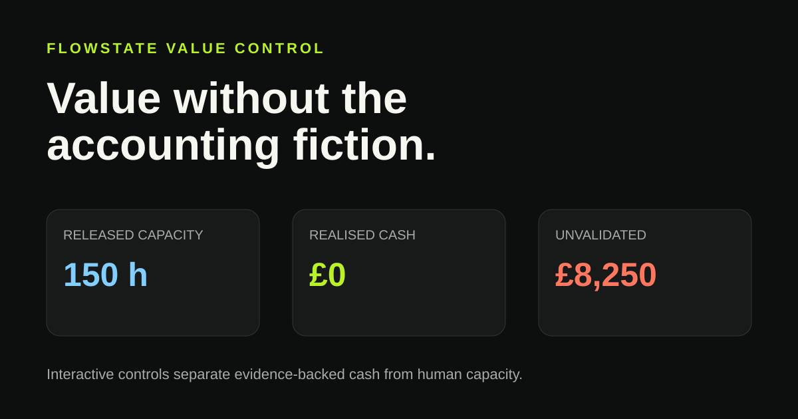

# Flowstate Decision Learning & Savings Engine

An interview technical project for Flowstate: a small, runnable engine that turns accepted and rejected AI-assisted work across business functions into auditable optimisation recommendations—without turning every saved minute into fictional cash.

[](https://github.com/wills-dtb/flowstate-decision-learning-engine/actions/workflows/ci.yml)

[](https://wills-dtb.github.io/flowstate-decision-learning-engine/)

**[Open the interactive savings slider →](https://wills-dtb.github.io/flowstate-decision-learning-engine/)**  
The demo is plain HTML/JavaScript in `docs/index.html`; it can also be opened locally. GitHub Pages must be enabled after repository creation for the hosted link to resolve.

## What it demonstrates

- Captures review outcomes from Marketing, Sales, Operations, People, Legal, Finance, or any other function using a common event contract.
- Learns at the `workflow × tool` level from both accepted and rejected work.
- Uses Beta smoothing so small cohorts do not appear certain.
- Applies deterministic controls for sample size, posterior acceptance, quality, defect rate, and optional cross-function evidence.
- Emits explicit reasons when a recommendation is blocked.
- Counts benefits from accepted work only.
- Reports **realised cash savings**, **released human capacity**, and **unvalidated cost avoidance** separately.

## Run it

Requires Python 3.11+; the engine itself has no third-party runtime dependencies.

```bash
PYTHONPATH=src python -m flowstate_equity.cli fixtures/work_events.csv --cross-function
```

Or install the command locally:

```bash
python -m venv .venv
source .venv/bin/activate
python -m pip install -e .
flowstate-equity fixtures/work_events.csv --cross-function
```

Write a report and provide explicit cash evidence:

```bash
flowstate-equity fixtures/work_events.csv \
  --cross-function \
  --cash-evidence contract \
  --output report.json
```

Without `--cash-evidence`, cost avoidance remains unvalidated and realised cash is zero. Run the slider locally with `python -m http.server 8000 -d docs`, then visit `http://localhost:8000`.

## Test

```bash
PYTHONPATH=src python -m unittest discover -s tests -v
```

CI runs tests, the sample CLI workflow, and a simple high-signal secret-pattern scan.

## Input contract

Each CSV row is one human-reviewed AI-assisted work event. Synthetic examples are in `fixtures/work_events.csv`.

| Field | Meaning |
|---|---|
| `event_id`, `occurred_at` | Unique lineage and event time |
| `function`, `workflow`, `tool` | Cross-functional context and treatment |
| `decision` | `accepted` or `rejected` by a human reviewer |
| `quality_score`, `defect` | Normalised outcome signals |
| `baseline_minutes`, `actual_minutes` | Capacity comparison |
| `baseline_cost`, `actual_cost` | Cost comparison—not automatically cash |
| `reviewer_role` | Governance context; do not put names here |

## Architecture

```text
AI-assisted work → human decision event → schema/lineage validation
                                            ↓
                         workflow × tool evidence cohorts
                                            ↓
                        smoothed outcome learning (Beta prior)
                                            ↓
              controls: sample · quality · defects · cross-function
                              ↓ approved          ↓ blocked + reasons
                       recommendation          audit trail
                              ↓
         benefits ledger: cash | capacity | unvalidated cost equivalent
```

The core is functional and stateless. `io.py` validates the boundary, `engine.py` learns and classifies, and `cli.py` composes them. This makes the policy easy to test and later place behind an API, queue, or warehouse job.

## Decision moat

The defensible asset is not a generic prompt or model. It is the governed history of which outputs were accepted, rejected, corrected, or later found defective—in context. Over time this dataset can improve routing, controls, retrieval and evaluation for each workflow while retaining reusable cross-functional priors. The moat only compounds if events have lineage, reviewer accountability, stable outcome definitions and feedback-delay handling.

## Controls and trade-offs

- **Beta(1,1) smoothing** is transparent and useful for a demo, but not a causal estimate. A production system should use time-aware holdouts or randomised rollout where possible.
- **Cohort-level learning** is explainable but can hide segment effects. Production should monitor function, team, risk tier and demographic proxies for disparate failure rates.
- **Hard gates** are auditable but blunt. Thresholds should be versioned per risk class and approved by control owners.
- **Quality scores** are assumed calibrated. In reality, rubric versions, reviewer agreement and delayed downstream outcomes must be measured.
- **Baseline comparisons** are observational. Seasonality, work complexity and selection bias can inflate apparent value.
- **Cash evidence** is a minimal boolean proof in this build. Production needs ledger/contract references, finance sign-off, effective dates, non-duplication rules and reversal entries.

## Privacy and security

This build uses synthetic data only. A production deployment should minimise content capture: store outcome metadata and hashes rather than prompts or outputs where possible; pseudonymise actors; enforce tenant and purpose boundaries; encrypt in transit/at rest; apply retention and deletion policies; audit access; and prohibit sensitive personal data in free text. Reviewer roles are preferable to names. Recommendations should not be used for employee performance decisions.

Before ingesting client data, complete a DPIA, threat model, data-processing terms, regional residency review, and model-provider retention assessment. Use least-privilege service identities and a secrets manager; never put credentials in events or source control.

## Production limitations / next increments

This is a compact proof, not a production savings ledger or autonomous decision-maker. It has no authentication, database, API, model integration, multi-tenancy, streaming ingestion, rubric calibration, causal inference, drift detection, approval UI, or finance-system reconciliation. A sensible next path is: append-only event store → policy registry and signed approvals → delayed-outcome joins → controlled rollout/holdouts → finance evidence workflow → monitoring and rollback.

## Repository scope

This repository supports an existing Flowstate interview opportunity. It is a technical illustration, not a new startup or commercial claim, and it is not affiliated with or endorsed by Flowstate.

